# Examples

1) [Tiny](./samples/desktop/Tiny/Tiny.cpp)

A basic example showing how to render a triangle.

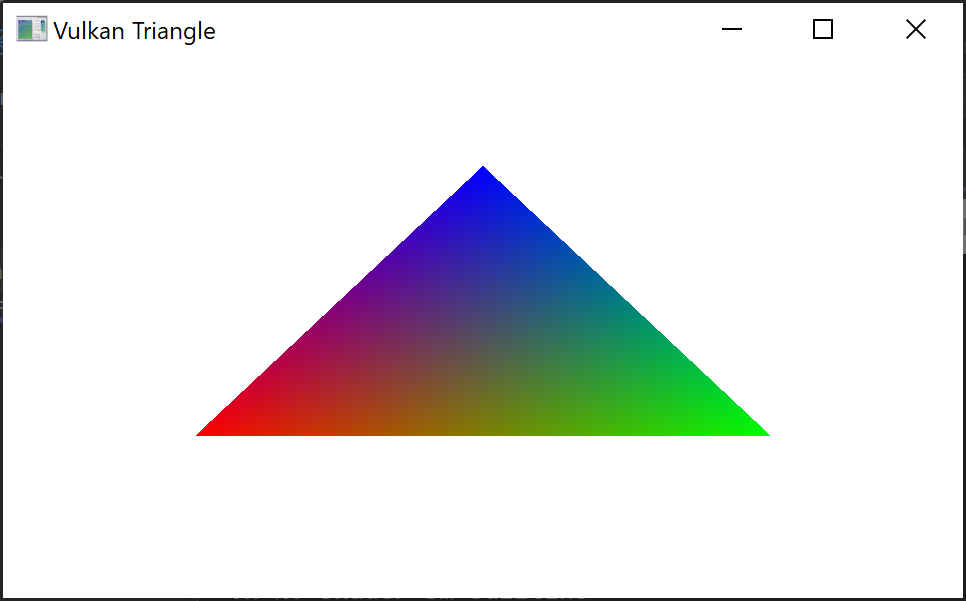

2) [Tiny_Mesh](./samples/desktop/Tiny/Tiny_Mesh.cpp)

An intermediate example showing how to render multiple textured meshes and ImGui integration.

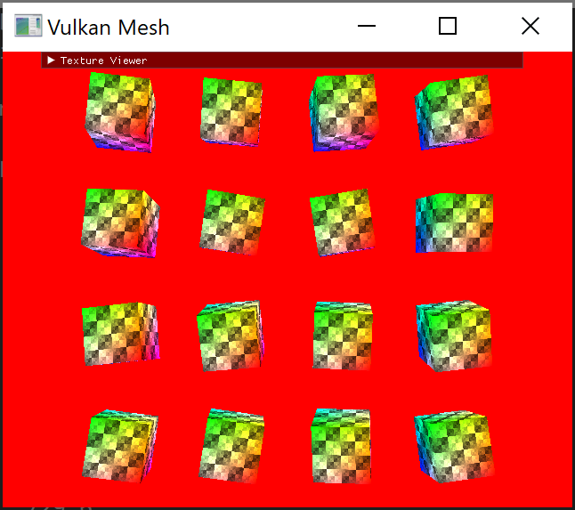

3) [Tiny_MeshLarge](./samples/desktop/Tiny/Tiny_MeshLarge.cpp)

A complex example demonstrating most of IGL features and rendering the Lumberyard Bistro mesh. Learn how to draw the rest of the owl.

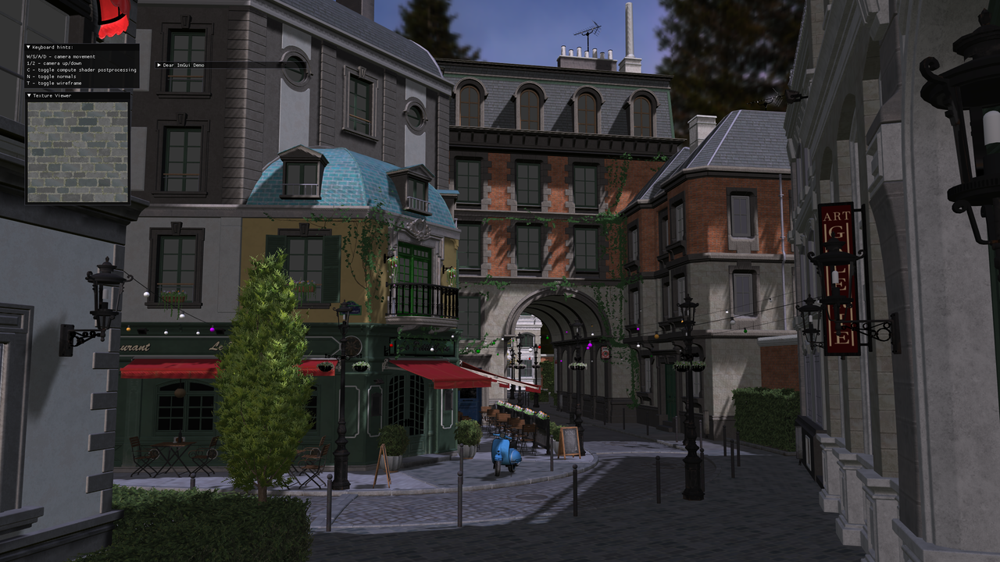

# RenderSessions

RenderSessions use iglshell functionality that provides platform abstraction and basic application functionality.
They are built when `IGL_WITH_SAMPLES` is enabled, which is the default.

## Start here

1)  [EmptySession](./shell/renderSessions/EmptySession.cpp)

An empty session. You can use it as a template for a new project

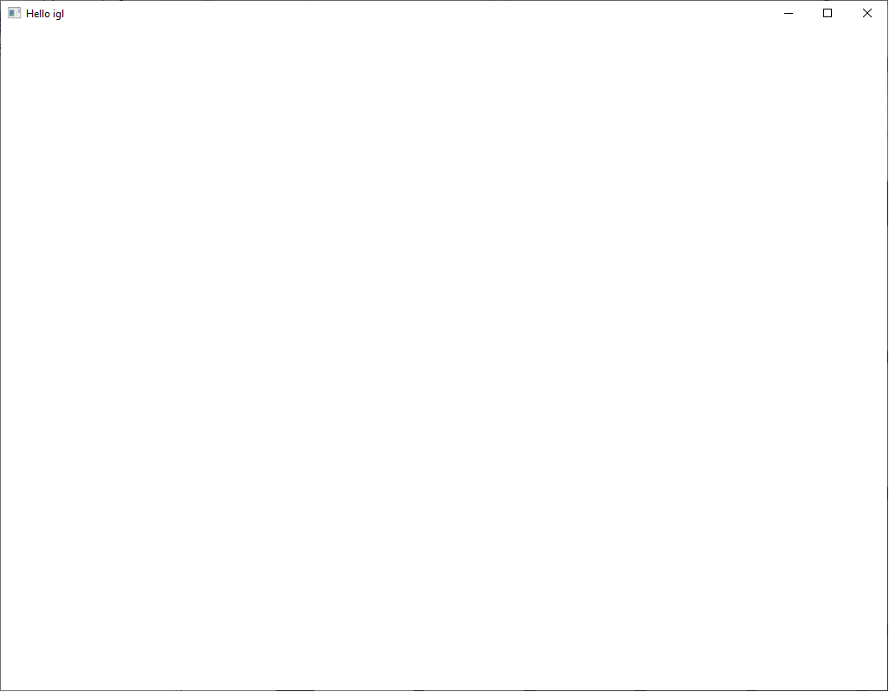

2)  [BasicFramebufferSession](./shell/renderSessions/BasicFramebufferSession.cpp)

A basic session showing how to create a framebuffer

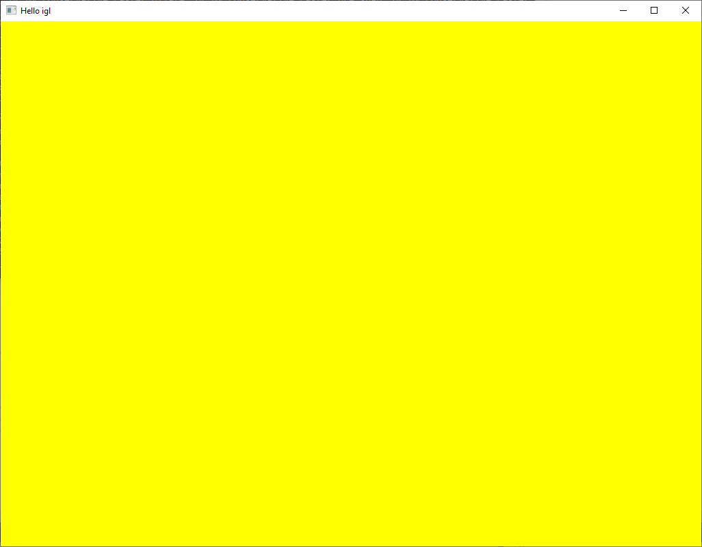

3)  [HelloWorldSession](./shell/renderSessions/HelloWorldSession.cpp)

A basic session showing how to render a triangle

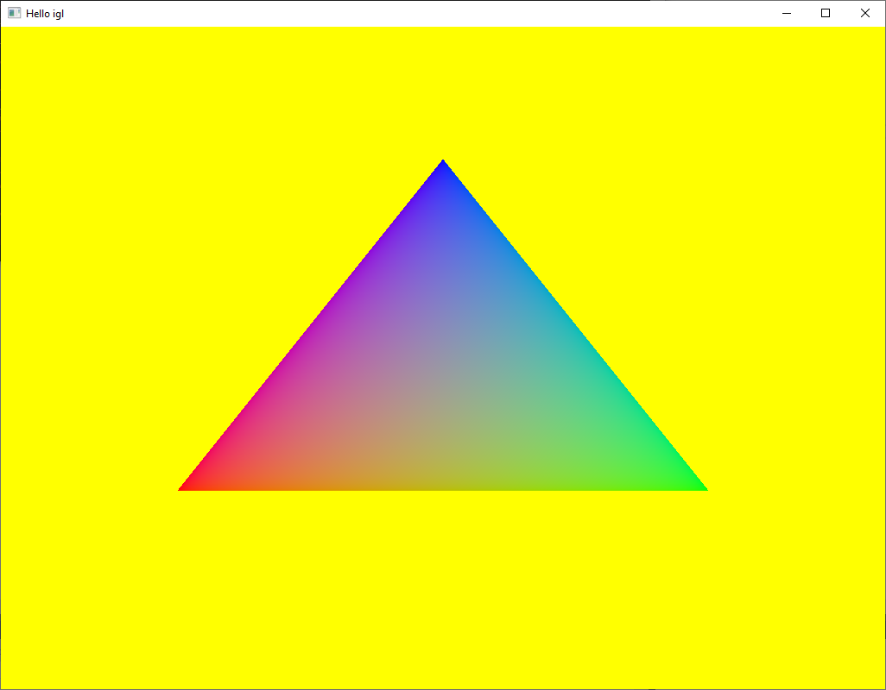

4)  [ColorSession](./shell/renderSessions/ColorSession.cpp)

A basic session showing how to render a textured quad

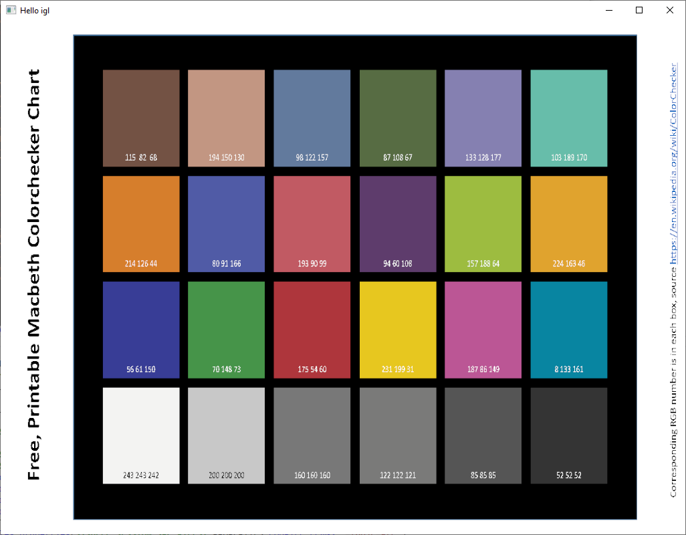

5)  [ImguiSession](./shell/renderSessions/ImguiSession.cpp)

A basic session showing how to use ImGUI with IGL

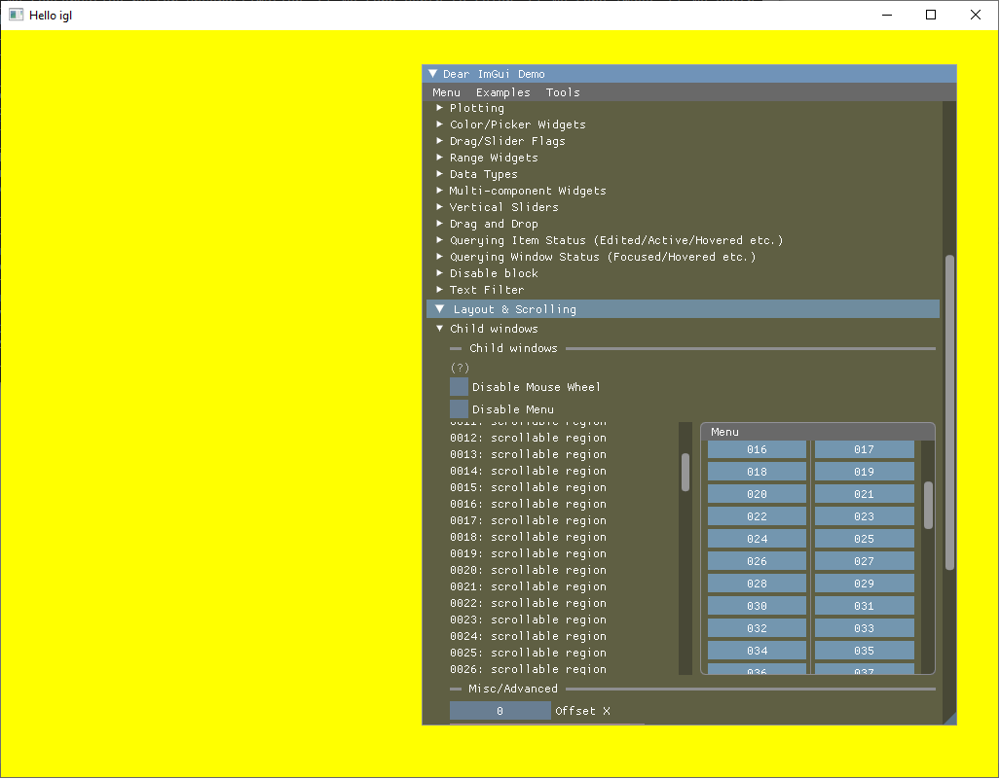

6)  [MRTSession](./shell/renderSessions/MRTSession.cpp)

A basic session showing how to use multiple render targets feature

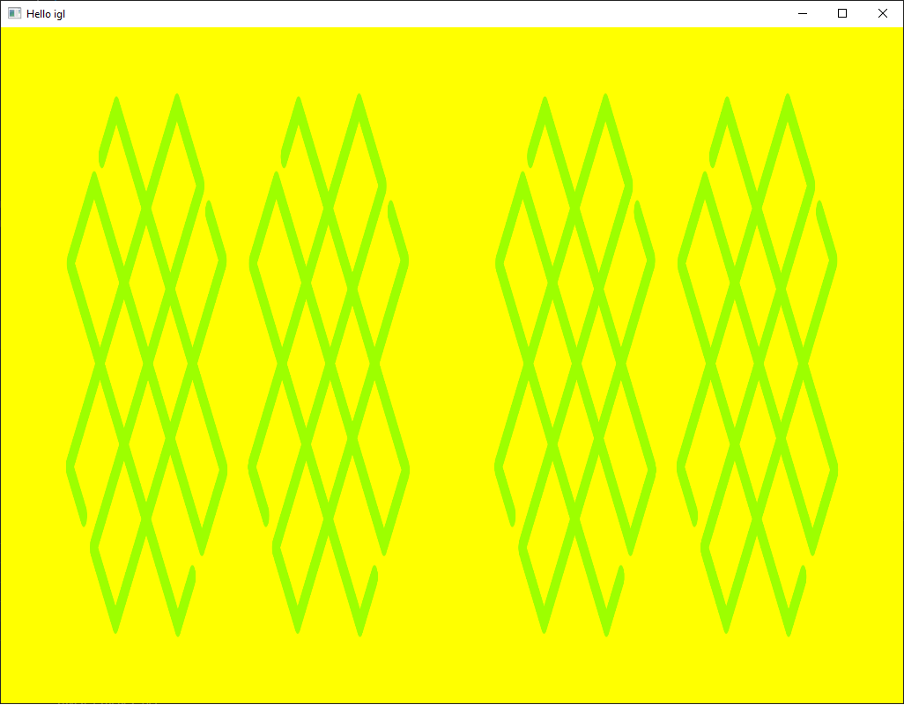

7)  [Textured3DCubeSession](./shell/renderSessions/Textured3DCubeSession.cpp)

A basic session showing how to use 3D textures

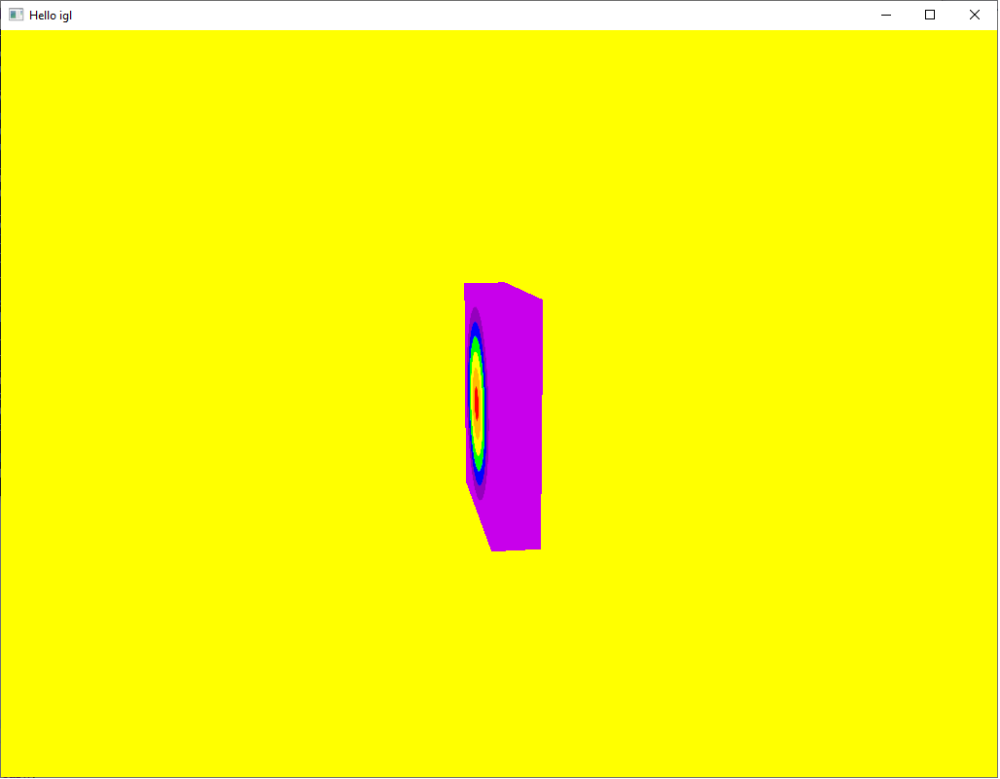

8)  [TQMultiRenderPassSession](./shell/renderSessions/TQMultiRenderPassSession.cpp)

A basic session showing how to use multiple render passes

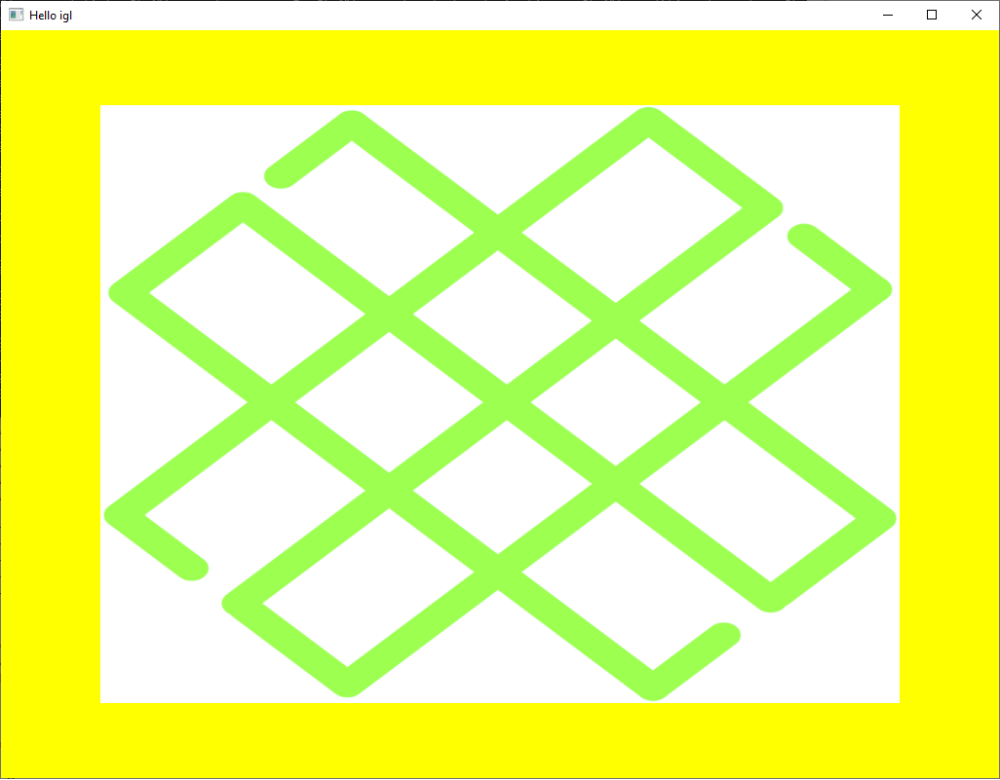

9)  [TQSession](./shell/renderSessions/TQSession.cpp)

A basic session rendering a textured quad with generated mipmaps

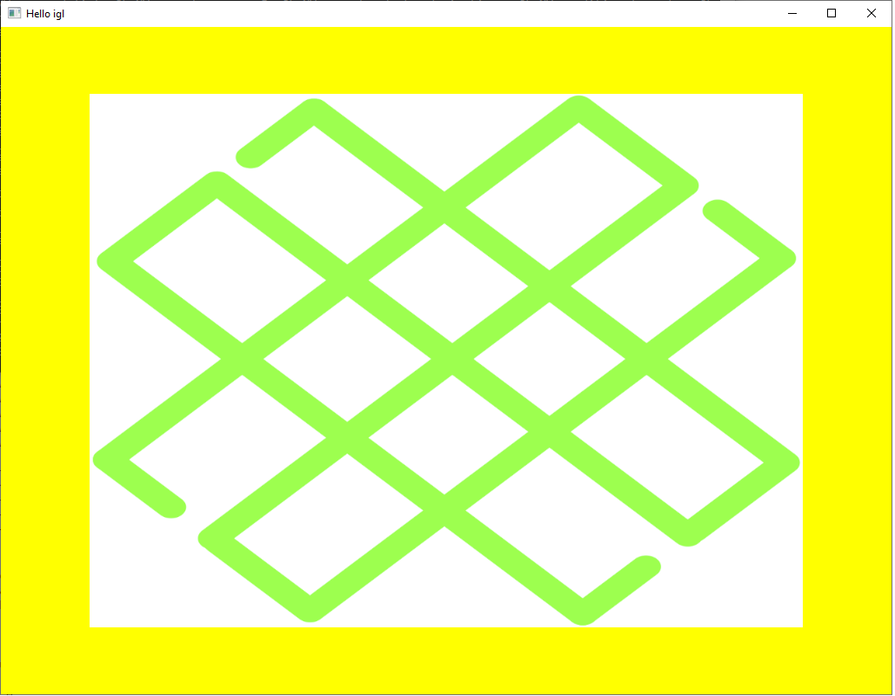

## Resources and bindings

| Session | What it shows |
|---|---|
| [BindGroupSession](./shell/renderSessions/BindGroupSession.cpp) | Binding textures and buffers through bind groups |
| [BindlessBufferSession](./shell/renderSessions/BindlessBufferSession.cpp) | Addressing buffers in the shader via `DeviceFeatures::BufferDeviceAddress` |
| [BufferMappingSession](./shell/renderSessions/BufferMappingSession.cpp) | Updating a buffer with `map()` / `unmap()` instead of `upload()` |
| [CopyOperationsSession](./shell/renderSessions/CopyOperationsSession.cpp) | Reading a color attachment back to the CPU with `copyBytesColorAttachment()` |
| [TextureViewSession](./shell/renderSessions/TextureViewSession.cpp) | Creating texture views over mip levels and array layers |
| [CheckerboardMipmapSession](./shell/renderSessions/CheckerboardMipmapSession.cpp) | Generating mipmaps and watching the level selection change |
| [YUVColorSession](./shell/renderSessions/YUVColorSession.cpp) | Sampling NV12 and 420p YUV textures, as single-plane and per-plane samplers |

## Pipeline and raster state

| Session | What it shows |
|---|---|
| [SpecConstantsSession](./shell/renderSessions/SpecConstantsSession.cpp) | Specialization constants, one shader compiled into several pipelines |
| [DepthBiasSession](./shell/renderSessions/DepthBiasSession.cpp) | `setDepthBias()` for coplanar geometry |
| [ScissorTestSession](./shell/renderSessions/ScissorTestSession.cpp) | Restricting rendering with the scissor rectangle |
| [StencilOutlineSession](./shell/renderSessions/StencilOutlineSession.cpp) | Drawing an outline with the stencil buffer |
| [WireframeSession](./shell/renderSessions/WireframeSession.cpp) | `PolygonFillMode::Line` over a filled pass |
| [SubpassDeferredSession](./shell/renderSessions/SubpassDeferredSession.cpp) | Subpasses with input attachments, for tile-based deferred shading |

## Draw calls and compute

| Session | What it shows |
|---|---|
| [DrawInstancedSession](./shell/renderSessions/DrawInstancedSession.cpp) | Instanced drawing |
| [MultiDrawIndexedIndirectSession](./shell/renderSessions/MultiDrawIndexedIndirectSession.cpp) | `multiDrawIndexedIndirect()` with draw parameters in a storage buffer |
| [MeshShaderTriangleSession](./shell/renderSessions/MeshShaderTriangleSession.cpp) | A task/mesh shader pipeline and `drawMeshTasks()` |
| [FireworksSession](./shell/renderSessions/FireworksSession.cpp) | A GPU particle system, billboarded in the vertex shader |

## Meshes and larger scenes

| Session | What it shows |
|---|---|
| [TinyMeshSession](./shell/renderSessions/TinyMeshSession.cpp) | The Tiny_Mesh sample as a render session, with ImGui |
| [TinyMeshBindGroupSession](./shell/renderSessions/TinyMeshBindGroupSession.cpp) | The same scene driven through bind groups |

## Profiling and stress

| Session | What it shows |
|---|---|
| [GPUTimerSession](./shell/renderSessions/GPUTimerSession.cpp) | Timing GPU work with `ITimer` and `CommandBufferDesc::timer` |
| [GPUStressSession](./shell/renderSessions/GPUStressSession.cpp) | A configurable load generator, including multiview |

## Slang

Two sessions are written entirely in [Slang](https://shader-slang.org) and run the same shader
source on every backend. See [shell/renderSessions/slang/README.md](./shell/renderSessions/slang/README.md)
for what each program does, and [tools/slang/README.md](./tools/slang/README.md) for how the
generated headers are produced.

| Session | What it shows |
|---|---|
| [SlangSplatsSession](./shell/renderSessions/SlangSplatsSession.cpp) | Fits 2048 anisotropic 2D splats to an image by gradient descent on the GPU, using Slang's reverse-mode autodiff. Runs on every backend; backends with compute train live, the rest draw splats trained ahead of time |
| [SlangShowcaseSession](./shell/renderSessions/SlangShowcaseSession.cpp) | A grid of physically based spheres: generic and dynamically dispatched material lobes, then inverse rendering that recovers their parameters. Metal and Vulkan only |

## OpenXR

Built when `IGL_WITH_OPENXR` is enabled.

| Session | What it shows |
|---|---|
| [HelloOpenXRSession](./shell/renderSessions/HelloOpenXRSession.cpp) | A minimal OpenXR session (Android, and Windows through the OpenXR simulator) |
| [HandsOpenXRSession](./shell/renderSessions/HandsOpenXRSession.cpp) | Hand tracking on Android |
